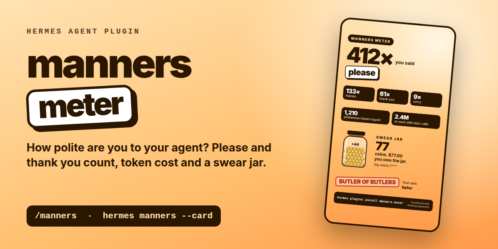

# manners-meter: how polite are you to your agent?



Do you say "please" and "thank you" to your agent? manners-meter counts it. It reads the messages you typed in your own Hermes history and shows:

- **Politeness:** how often you said please, thanks, thank you, sorry, bitte, danke, vielen dank, por favor, gracias, merci and a few more.
- **What it cost:** an estimate of the tokens you typed for it, and how many tokens were re-sent with every later model call of the same chat.
- **The swear jar:** every swear word you aimed at your agent is a coin in the jar. You set the price per coin.
- **Your rank:** from "Cold Commander" to "Butler of Butlers", plus "Saint" to "Sailor" for the jar.
- **A share card:** one HTML file in story format (1080 x 1920) to screenshot and post.

Optional and on by default: when one of your messages contains a swear word, the agent gets a short note with the new jar count and may answer with one dry line. Live example (Claude Haiku 4.5):

> **You:** Damn, this shit keeps breaking. One sentence please.
> **Agent:** Coin in the jar. What's breaking?

Read only, no model calls, no network. Standard library only.

## Who it is for

- **Anyone who wondered whether "please" costs money.** It is a running joke that politeness to chatbots costs real compute. This puts a number on your own share.
- **People who like to post their stats.** The share card is built for stories and feeds, and it says that nothing was uploaded.
- **Teams and trainers, as a starting point.** It is a light way to show what lands in the context of a model. It is not an analytics tool: counts are word matches, token figures are estimates.

## Beyond this plugin

manners-meter is free and stays free. Real usage analytics for a company need its own data, so they are not a public plugin:

- dashboards across all users and profiles of a company instance, with roles;
- cost reports from the provider bills instead of estimates;
- usage reviews that show where a team loses time or tokens.

[MadeByBrain](https://madebybrain.com), the maintainer of this plugin, plans and builds such Hermes setups for businesses.

## Install

```bash
hermes plugins install MadeByBrain/hermes-extensions/plugins/manners-meter --enable
```

Pin a release with `--ref <40 character commit SHA>` (tags are not accepted by `--ref`).

## Use it

In any chat (CLI, TUI, Desktop, Telegram and the other gateways):

```text
/manners           all time
/manners 30        last 30 days
/manners chat      this chat only
/manners card      write the share card and show its path
/manners json      raw numbers
```

In the terminal:

```bash
hermes manners
hermes manners --days 30
hermes manners --json
hermes manners --card              # default path under plugin-data/manners-meter/
hermes manners --card ~/card.html
```

Example output:

```text
Manners meter (all time)
7,629 messages from you in 794 chats
You were polite 1,291x: "bitte" 834x, "danke" 218x, "please" 129x, "vielen dank" 43x, "thank you" 25x
Tokens you typed for it: 2,653
Re-sent with every later model call: about 510k (mostly from cache, at most $1.53 uncached at $3.00 per million)
Your agent answered "you're welcome": 2x
Swear jar: 11 coins = $11.00. Top word: mist
Rank: Polite Professional / Mostly Clean
Counted locally from state.db. Nothing left your machine.
```

The share card is plain HTML without external fonts, scripts or images. Open it in a browser and take a screenshot, or render it headless, for example with Chrome: `chrome --headless --window-size=1080,1920 --screenshot=card.png card.html`.

## How it counts

- **Only what you typed.** Code blocks, quoted lines (`> ...`) and injected system blocks are skipped. Sessions from `cron`, `subagent`, `kanban`, `batch`, `webhook` and `tool` are ignored, because a machine wrote those messages.
- **Word matches.** Case insensitive, on word boundaries, so "pleased" or "mistake" do not count. Phrases win over their single words: "vielen Dank" is one "vielen dank", not also a "danke". Swear words are shown masked (f***, s***).
- **Tokens are estimates.** About 4 characters per token, no tokenizer. "Re-sent" multiplies the polite tokens of a message by the number of model answers that followed in the same chat, because the whole history goes with every call. Most of that is served from the prompt cache, so the dollar figure is an upper bound for uncached input, not a bill.
- **"You're welcome" from the agent** is counted only in the first 200 characters of an answer, where it usually stands. That keeps a large history fast.
- **Language.** `auto` picks German or English by the words you use most.

## Settings

Set with `hermes config set plugins.entries.manners-meter.settings.<key> <value>` or in the Desktop plugin settings.

| Key | Default | What it does |
|---|---|---|
| `language` | `auto` | `auto`, `en` or `de` |
| `jar_reactions` | `true` | Note to the agent when your message contains a swear word. `false` = counting only |
| `jar_price` | `1.0` | Price per coin |
| `currency` | empty | Empty = € in German, $ in English |
| `price_per_mtok` | `3.0` | Input price per million tokens (USD), only for the uncached upper bound |
| `extra_polite` | `[]` | Your own polite words |
| `extra_swear` | `[]` | Your own swear words |
| `excluded_sources` | `[cron, subagent, kanban, batch, webhook, tool]` | Sources that are not you |

## Data and privacy

- Reads `state.db` of the active profile **read only**. Never writes to it.
- Writes only the share card, by default to `<HERMES_HOME>/plugin-data/manners-meter/manners-card.html`.
- No network, no model calls, no telemetry.
- The swear jar note (`jar_reactions`) is added to your own message through the `pre_llm_call` hook, never to the system prompt, so the prompt cache stays intact. It names the matched word and the jar count, nothing else. Turn it off with `jar_reactions: false`.
- Session titles and message texts never appear in the output or on the card.

## Tested

- 18 offline tests (counting rules, filters, report, slash command, CLI, card, jar hook, timing with 200k character inputs).
- `hermes plugins validate --json`: no warnings.
- Live in an isolated Hermes home (Hermes Agent v0.22.7, Claude Haiku 4.5 over OpenRouter): plugin loaded by the real plugin manager, `/manners` and `hermes manners` ran against the new history, the swear jar note reached the model inside the user message and the model answered with "Coin in the jar."
- Run against one real history (1.6 GB state.db, about 7,600 typed messages, 11,000 cron sessions skipped): about 2 seconds.
- Not tested yet: Windows, and the slash command on Telegram, Discord and Desktop (same code path, but not seen live).

## License

MIT. See [LICENSE](LICENSE).
