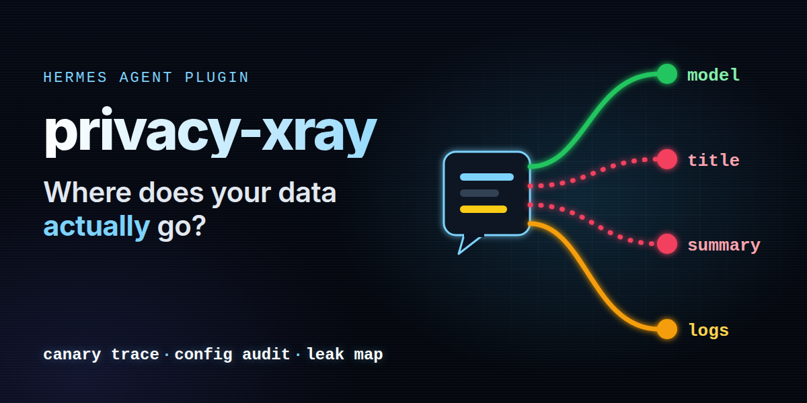

# privacy-xray: where does your data actually go?



You type a client's name into Hermes. It goes to your main model, as expected. It may also go to a second vendor that writes the chat title, to a third that summarizes long chats, into `state.db`, into the logs and into a session title. None of that is visible in the chat.

privacy-xray makes it visible:

- **Flow ledger.** Every outgoing model request is recorded as metadata: main requests (`pre_api_request`) and side requests such as title generation, compression, vision or approvals (`pre_auxiliary_call`). For each one: destination host, vendor, the country of the vendor's headquarters, size, and counts of detected personal data types. Never the content.
- **Canary trace.** `/xray canary` invents a person with fake but realistic data. Mention it in a normal message, then `/xray trace` shows every request and every local store that carried it.
- **Config audit.** `/xray check` lists the paths Hermes itself configures on which content leaves the machine (main model, fallbacks, each side task and its fallback chain, memory provider, web search with its fallback, web page reading, browser, voice, gateways), plus local stores at rest. Each finding has a severity and, where it is safe, the exact `hermes config set` fix. `/xray fix <id> --yes` applies one.
- **Subject finder.** `/xray find "<name or e-mail>"` searches the local Hermes stores read-only and can write a Markdown and JSON access report (in the style of a GDPR Art. 15 request).
- **Leak map.** `/xray map` in the chat, `/xray report` as a self-contained HTML file: a one-sentence verdict ("Your canary reached 2 vendors in 1 country"), a flow map from Hermes through each task to each vendor (band width = number of requests, moving dots = requests, yellow dots = the canary, a pulsing red outline on extra recipients that saw personal data), and a before/after view when two canaries were sent out, for example one before and one after a fix. Every block names its scope: the verdict card covers the latest canary only; when that canary is the "after" side of a before/after pair, the flow map starts when it was created (so it shows the state after your change and the earlier traffic stays in the before/after view), otherwise the flow map covers the last turns.
- **Dashboard tab.** The same leak map live in the Hermes web dashboard (`hermes dashboard`, tab "Privacy X-ray"), refreshed every 15 seconds.
- **Guard (optional, off by default).** Masks canary values and your watch terms in the text of main model requests before they are sent.

Local only: no network calls, standard library only. The plugin itself never deletes anything. One piece of advice it prints (`hermes config set sessions.auto_prune true`, for chat retention) would make Hermes delete old chats; it comes with a warning and is never applied by the plugin, not even with `--yes`.

> **Not legal advice and not a compliance certificate.** privacy-xray shows where data goes. Whether a transfer is lawful depends on contracts, settings and facts it cannot see.

## Who it is for

- **Anyone who puts real names, mail addresses or customer data into Hermes** and wants to know which companies receive them, beyond the main model.
- **Teams in the EU and other regions with data protection rules** who need to answer "where do our chats go?" for a record of processing or a customer questionnaire.
- **Consultants and data protection officers, as a starting point.** It covers what Hermes itself sends and stores. It does not cover what a vendor does with the data after receipt, where it is processed, what your tools (MCP servers, scripts) send on their own, or backups. It does not check contracts.

## Beyond this plugin

privacy-xray is free and stays free. Making a Hermes setup fit a company's data protection needs depends on its own data, vendors and contracts, so it is not a public plugin:

- pseudonymisation of names and IDs for all requests, with the company's own lists (clients, employees, case numbers);
- side tasks moved to a local or in-region model, so titles and summaries never leave the machine;
- a record of processing and an audit trail exported for the data protection officer;
- retention and deletion workflows for access and erasure requests.

[MadeByBrain](https://madebybrain.com), the maintainer of this plugin, plans and builds such Hermes setups for businesses.

## Install

```bash
hermes plugins install MadeByBrain/hermes-extensions/plugins/privacy-xray --enable
```

To install one exact version, pin the commit (the `--ref` option takes a full 40 character commit SHA, not a tag):

```bash
hermes plugins install MadeByBrain/hermes-extensions/plugins/privacy-xray --ref <commit-sha> --enable
```

Requires Hermes Agent v0.22.7 or newer; tested on v0.22.7 and v0.23.0. No Python dependencies. With a running gateway, the plugin loads after `hermes gateway restart`.

## The canary demo (2 minutes)

```text
/xray canary
```

```text
🐤 New canary created: a fictitious person, every value is fake.
  Name    Ida Holtingham
  E-mail  ida.holtingham.9c12@example.org
  IBAN    DE23 0388 2419 9059 3378 38  (valid check sum, no real bank)
  Phone   +44 7700 900451  (UK range reserved for fiction)
```

Now chat normally, for example "Write a short payment reminder to Ida Holtingham (ida.holtingham.9c12@example.org), IBAN DE23 0388 2419 9059 3378 38." Then:

```text
/xray trace
```

This is real output from the test run of the first build (Hermes v0.22.7, main model Claude Opus on Anthropic, title generation and compression pinned to a model on OpenRouter); the current build labels the OpenRouter lines with the model's vendor, see [Aggregators](#aggregators-openrouter-and-similar):

```text
🐤 Canary Ida Holtingham (ce4be0e), created 2026-11-05 23:04: found in 6 places.
Sent out (3)
  🟢 main request → api.anthropic.com · Anthropic, vendor HQ US · 5 request(s) · in user, assistant
  🔴 side request: compression → openrouter.ai · OpenRouter, vendor HQ US · 1 request(s) · in user
  🔴 side request: title_generation → openrouter.ai · OpenRouter, vendor HQ US · 3 request(s) · in user
Stored on this machine (3)
  • state.db session titles: 2
  • state.db messages: 5 message(s) in 2 session(s) (assistant 3, user 2)
  • logs/agent.log: 4 hit(s)
Searched, nothing found: session files, memory files, other plugins' data.
```

`/xray check` names the two red side tasks and the fix. After `/xray fix aux.title_generation --yes` and `/xray fix aux.compression --yes`, a second canary in the same test went to one recipient only:

```text
  🟢 main request → api.anthropic.com · Anthropic, vendor HQ US · 3 request(s) · in user, assistant
  🟢 side request: compression → api.anthropic.com · Anthropic, vendor HQ US · 1 request(s) · in user
  🟢 side request: title_generation → api.anthropic.com · Anthropic, vendor HQ US · 1 request(s) · in user
```

The fake values: the e-mail domain `example.org` is reserved for documentation (RFC 2606); the IBAN has a valid check sum with a bank code starting with 0, outside the regular German clearing areas 1 to 8; the phone number is in the UK range +44 7700 900000 to 900999 that Ofcom reserves for drama and fiction.

## Commands

| Command | What it does |
|---|---|
| `/xray` | Status: requests recorded, destinations, active canary, last check, guard. |
| `/xray check` | Config audit. Non-green findings with the fix; green ones in one line (`--all` lists them too). |
| `/xray fix <id>` | Shows what the fix runs. Nothing changes. |
| `/xray fix <id> --yes` | Applies the fix, then checks again. Only on this machine (see [Chat gateways](#chat-gateways)). |
| `/xray canary` | Creates a new canary person (the last five are kept). |
| `/xray trace [canary-id] [--deep]` | Where the canary went: requests since it was created, and local stores. An unknown id lists the known ones. |
| `/xray map [--session \| --turns N \| --hours N]` | Leak map in the chat (default: last 20 turns). |
| `/xray report [--session]` | Writes the HTML leak map to `plugin-data/privacy-xray/reports/` and prints the path. |
| `/xray find "<name or e-mail>" [--export] [--deep]` | Read-only search of the local stores, with masked snippets; `--export` writes the access report (and always includes the deep pass). Only on this machine. |

Wrong arguments get a short usage line in English or German, never a Python error. The model can use the same information through the tool `privacy_xray` (actions `map`, `check`, `trace`, `find`), so "which companies see my chats?" works in plain language. The tool never changes settings; it tells the user which `/xray fix` to run. Its `find` action follows the same rule as `/xray find` (this machine only).

## How the config audit decides

Read from the Hermes source (v0.22.7), not guessed: a side task with provider `auto` or empty uses the main provider and the main model; only if that is unavailable does Hermes fall back to `fallback_providers`. An explicit `auxiliary.<task>.provider`, `model` or `base_url` wins, and when that fails Hermes tries `auxiliary.<task>.fallback_chain` (listed as its own finding).

### Aggregators (OpenRouter and similar)

OpenRouter, Vercel AI Gateway, Kilo Code, OpenCode, the Hugging Face router and Novita (the providers Hermes itself marks as aggregators) forward a request to a model vendor. privacy-xray reads that vendor from the model id (`deepseek/deepseek-v4-flash` is a DeepSeek model) and shows it as `OpenRouter → DeepSeek model` in check, map, trace and report. A side request is an extra recipient when the aggregator or the model's vendor differs from your main route: main model `anthropic/claude-sonnet-5` on OpenRouter and titles with `deepseek/deepseek-v4-flash` on OpenRouter is red. Which company finally processes a request behind an aggregator (the model's vendor or a hosting partner) is not visible to the plugin.

### Web search and web page reading

Read from `agent/web_search_registry.py` and `tools/web_tools_rescue.py`: `web.search_backend` and `web.extract_backend` fall back to `web.backend`, then to an auto-detected vendor, then (with `web.keyless_fallback` on, the default) to a keyless free tier (Exa, Parallel, Firecrawl, Keenable). With `web.keyless_rescue` on (the default), a call that fails on your chosen backend is retried once on that free tier. So a self-hosted SearXNG is green only when `web.keyless_rescue` (or `web.keyless_fallback`) is off; the finding `web.rescue` has the fix. `web.extract` names the vendor that fetches the pages the agent reads. `ddgs` is a meta search over several engines (DuckDuckGo, Bing, Brave and others).

| Severity | Meaning |
|---|---|
| 🟢 green | Stays local, goes to the same recipient as the main model, or is turned off. |
| 🟡 amber | An additional recipient for narrow data (images, commands, skill texts), a fallback model, web search and page reading, the web fallback, gateways, chat history kept until you delete it, main model outside your `home_region`. |
| 🔴 red | An additional recipient that gets the conversation itself (title generation, compression, review, memory rewrite, MoA), an external memory provider, or request dumps on disk (complete prompts plus auth headers). |

Fixes run through `hermes_cli.config.set_config_value`, the same code as `hermes config set` (validation, atomic write). If one step of a fix fails, the steps before it are set back. For side tasks the fix is `provider auto` and `model ""`, which routes the task to your main model (`/xray fix <id>` says that this may cost more and take longer; it also names the effect of `stt.provider local` and `memory.provider ""`). Some findings have no automatic fix (request dumps, web search, page reading, gateways, chat retention); the check says what to do instead and the plugin applies nothing.

**Chat retention is advice only.** `sessions.retention` shows `hermes config set sessions.auto_prune true` with a warning: on its next start Hermes would then delete every chat older than `sessions.retention_days` (90 by default) from `state.db` and `sessions/`, for good. Deleting chats is your decision alone, so privacy-xray never runs this command, not even with `--yes`.

A changed setting applies from the next session (`/new`). Tested in the classic CLI on Hermes v0.22.7 and v0.23.0: after `/new` the side tasks went to the main model without a restart.

## Settings

Set with `hermes config set plugins.entries.privacy-xray.settings.<key> <value>` or in the desktop app.

| Key | Default | Meaning |
|---|---|---|
| `language` | `auto` | `en`, `de`, or `auto` (the Hermes display language). |
| `record` | `true` | Record outgoing requests in the ledger. |
| `detectors` | all | `email`, `iban` (mod 97), `card` (Luhn), `phone` (international `+` format only), `ipv4`, `tax_id_de` (German Steuer-ID with check digit), `vat_id_de` (German USt-IdNr with check digit). |
| `watch_terms` | `[]` | Your own words: client names, project code names. Counted in every request, masked by the guard. |
| `home_region` | `""` | For example `EU`, `EEA`, `DE` or `EU,CH`. A main model vendor headquartered outside is amber. |
| `guard` | `false` | Mask canary values and watch terms in main requests. |
| `ledger_max_mb` | `5` | Ledger size before one rotation. |
| `map_turns` | `20` | Turns shown by `/xray map`. |
| `scan_seconds` | `30` | Time budget for searching local stores. |
| `allow_sensitive_on_gateways` | `false` | Allow `/xray fix <id> --yes` and `/xray find` from chat gateways too. |
| `wrap_width` | `0` | CLI and TUI only: wrap `/xray` output at word boundaries at this width. `0` = the terminal width when the command runs inside the terminal, else 100 (on Hermes v0.23 slash commands run in the gateway, which cannot see the terminal). Commands in the output are never split. |

## Chat gateways

`/xray fix <id> --yes` changes your Hermes config, and `/xray find` shows excerpts from your local chats, logs and files. By default both run only on this machine: the classic CLI, the TUI, the desktop app, the web dashboard (Hermes passes the calling surface to the command as `platform`). From Telegram, Discord, Slack, WhatsApp, Signal and every other gateway they are refused with a short note, because everyone who may write to the bot could otherwise use them. The `api_server` surface is refused too, because the plugin cannot see whether the caller is on localhost; an empty or unknown surface is refused as well (fail closed). Showing a fix without `--yes`, check, map, trace and report work everywhere. Set `allow_sensitive_on_gateways` to `true` to allow both on gateways.

## What is stored

Under `<HERMES_HOME>/plugin-data/privacy-xray/` (folder mode 700, every file the plugin writes mode 600, also after a rotation):

- `ledger.jsonl` (and `ledger.1.jsonl` after rotation): one line per request with time, session and turn id, main or side task, provider, model, host, vendor, vendor HQ, for aggregators the model's vendor and its HQ, character count, counts per data type, canary id and the message fields it appeared in (system, user, assistant, tool), and `incomplete` when the request was too long to scan in full. No message text, no matched values.
- `canaries.json`: the fake persons.
- `last-check.json`, `last-trace.json`: the last results, for `/xray` and the report.
- `reports/`: HTML leak maps and access reports you asked for. An access report contains the masked search term, store names, counts and masked snippets.

The HTML leak map has no scripts and loads nothing from outside (inline CSS and SVG; the animations are CSS and stop with "reduce motion"). It shows the canary's fake name, e-mail and phone number, never message content. The dashboard tab shows the same page in a sandboxed frame; its backend route (`/api/plugins/privacy-xray/report`) sits behind the dashboard login and is only mounted when the plugin is in `plugins.enabled`.

## Honest limits

- **Detection is not exhaustive.** Patterns find e-mail addresses (not role mailboxes such as `git@` or `noreply@`), IBANs, payment cards (known issuer ranges with Luhn, never digits right after a `+`), international phone numbers, public IPv4 addresses (no loopback, private, link-local, CGNAT, multicast or reserved ranges, nothing that looks like a version number) and two German IDs. Names in free text are only found as canary values or watch terms, matched as whole words. Counts are per request: a long chat re-sends its history, so the same address is counted again in every request.
- **Long requests.** Per request, up to 2,000,000 characters of new text (1,000,000 per message) are scanned for data types, newest message first, so what just came in is always covered; repeated history is cached. When text did not fit, the ledger entry is marked `incomplete` and map, trace and report say "Count incomplete". Canary and watch-term matching covers up to 4,000,000 characters per message.
- **Side requests are visible, not blockable.** `pre_auxiliary_call` is an observer hook in Hermes; no plugin can change or stop a side request. The guard only masks main requests (through the `llm_request` middleware). The test run shows it: with the guard on, the main request carried no canary, while the title request still did. To keep data away from a side vendor, route the task to your main model (the fix) or turn it off.
- **What the guard masks, and what not.** It replaces canary values and watch terms, as whole words (the watch term `Tim` never touches `timestamp`), in human-readable text only: user and assistant text, system text (`system`, `instructions`), tool results (`role: tool`, Anthropic `tool_result`, Responses `function_call_output`). It never touches roles, types, ids, tool or function names, tool call arguments (`tool_calls`, `tool_use.input`, `function_call`), JSON keys, images, files, thinking or redacted thinking blocks, or any block carrying a signature or encrypted content. So a name the model writes into a tool call argument still goes out, and so does a name inside a thinking block. Other request shapes (for example Gemini's native `contents`) pass through unmasked.
- **Country = vendor headquarters, not processing location.** Many vendors run data centers in several regions. Behind an aggregator the model's vendor comes from the model id; the final processor is not visible. Unknown hosts are shown as unknown.
- **Local store search has a budget and says what it covered.** In `state.db` it takes candidates from Hermes' own full-text indexes and confirms them with `LIKE`. Hermes indexes tool output only up to its first 8 KB, so by default longer tool outputs are searched in that part only and the result says so; `--deep` (always on with `--export`) adds one pass over those long rows. Measured on this machine's 1.6 GB `state.db` (270,000 messages, read-only, warm page cache): indexed search 0.1 to 1.9 s per term, the deep pass about 1 s more; the first deep pass after a cold start took 16 s, because the tool rows are read from disk. A whole `/xray find` (state.db plus files) took 1.6 to 3.6 s. A file larger than 64 MB is read from its end (logs grow at the end); such files, and files a time budget cut short, are named, and the search counts as incomplete: on that machine a 267 MB `logs/mcp-stderr.log` makes every search say "Search incomplete" and the access report "Search complete: no". `LIKE` is case-insensitive only for ASCII letters (`MÜLLER` does not find `Müller`).
- **Not covered:** what vendors keep, MCP servers and tools that call the network themselves, other Hermes profiles, backups, external memory providers' storage, messaging platforms.
- Hermes v0.22.7 logs "unknown manifest field(s) ignored: provides_middleware" when it loads the plugin. The field is required by `hermes plugins validate`; the warning is harmless.

## Tested

- 79 offline tests, all passing on Hermes v0.22.7 and v0.23.0 (detectors with check digits, 1,000 random German mobile numbers that must never count as a card, public-only IPv4, message shapes of chat, Anthropic and Responses APIs, ledger without content, long histories newest first with the incomplete flag, rotation, file modes 700/600, guard on Anthropic thinking and tool_use blocks, chat completions tool_calls and Responses input, aggregator routing in audit, map, trace and report, web fallback audit, retention never applied, config audit, fix and rollback through the real Hermes config writer, gateway refusal through Hermes' real command dispatch, usage messages, search in a real Hermes `state.db` schema, large files, HTML report without scripts or external assets, verdict, before/after view, scope of verdict, flow map and chips, escaping, dashboard manifest and backend route, word wrapping in terminals), plus timing tests: every regex on 1,000,000 character adversarial inputs under one second.
- `hermes plugins validate --json`: no warnings.
- Live in an isolated Hermes home (Hermes v0.22.7) with Claude Opus (Anthropic) as main model and title generation and compression pinned to `deepseek/deepseek-v4.1-flash` on OpenRouter: canary, three chat turns, title generation and a forced compression, then trace (both side requests red as `OpenRouter → DeepSeek model, vendor HQ US / CN`), check (2 red), `fix --yes` refused with `platform` telegram and discord, `fix sessions.retention --yes` (config byte-identical), `fix aux.title_generation --yes` and `fix aux.compression --yes`, a second canary through the same turns (all three paths green, Anthropic only), and the HTML report with the before/after view ("Gone after the change: OpenRouter → DeepSeek model (US→CN)"). Plugin data folder 700, every file 600. The first build was also tested live with the guard on. Commands ran through Hermes' real plugin manager and command dispatch in the CLI code path; the gateway and desktop use the same command and hook code paths but were not tested live.
- Live on Hermes v0.23.0 (isolated home, same models and steps, real interactive CLI): before the fix both side requests red (`OpenRouter → DeepSeek model`), `/xray fix aux.title_generation --yes` and `/xray fix aux.compression --yes` applied (on v0.23 the command runs in the gateway with `platform` `local`), after `/new` a second canary green on all three paths without a restart, HTML report written. The dashboard tab renders in the v0.23 dashboard.
- Dashboard tab: tested in a `hermes dashboard` started on the isolated home (headless Chromium): the tab loads, renders the leak map, and a new ledger record changes the map on the next poll. The desktop app has no pane for privacy-xray.

## License

MIT. See [LICENSE](LICENSE).
