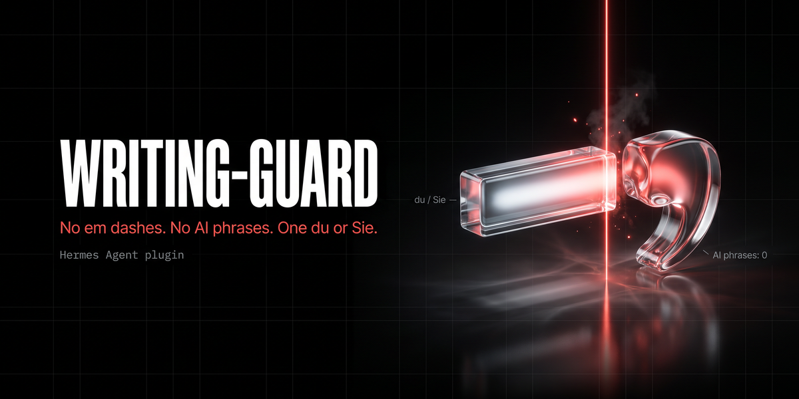

# writing-guard: style check for Hermes answers (German and English)



If your style rule for texts written with AI says no em dashes, no stock phrases and one form of address, models still break it. writing-guard checks the final answer of every Hermes turn against that rule before it is stored and shown:

- **Dashes:** finds em and en dashes outside code, links and quotes. Optionally replaces them by rule.
- **AI phrases:** reports stock phrases in German and English, such as "Es ist wichtig zu beachten", "Ich hoffe, das hilft", "It's important to note", "delve" or "seamless".
- **du and Sie:** in German answers, reports both forms in the same paragraph, a switch against the previous answer of the same chat, or the wrong form when you set one.

By default it only reports, with one line under the answer:

> *writing-guard: 2 Gedankenstriche; 1 KI-Floskel („Gute Frage“).*

Rule based: no model calls, no network, a few milliseconds per answer.

## Who it is for

- **Anyone who publishes or sends texts written with Hermes:** posts, newsletters, client mails, web pages, documentation. Teams with a style guide that bans dashes or stock phrases.
- **German speaking teams.** Mixing du and Sie is easy to miss in a long answer. No other plugin in the Hermes catalog checks it (October 2026).
- **Agencies and editors, as a starting point.** It checks surface rules. It does not judge tone, facts, or whether a text fits your brand, and it does not know your own style guide beyond the phrases you add.

## Beyond this plugin

writing-guard is free and stays free. A writing setup that really matches a company needs its own material, so it is not a public plugin:

- a style profile built from your own published texts, with your terms and banned words;
- checks for brand names, product names and legal wording that must not change;
- a review step before a text leaves the company (mail, CMS, social media scheduling).

[MadeByBrain](https://madebybrain.com), the maintainer of this plugin, plans and builds such Hermes setups for businesses.

## Install

```bash
hermes plugins install MadeByBrain/hermes-extensions/plugins/writing-guard --enable
```

To install one exact version, pin the commit (the `--ref` option takes a full 40 character commit SHA, not a tag; every GitHub release lists its SHA):

```bash
hermes plugins install MadeByBrain/hermes-extensions/plugins/writing-guard --ref <commit-sha> --enable
```

Requires Hermes Agent v0.22.2 or newer. No Python dependencies (standard library only). With a running gateway, the new plugin loads after `hermes gateway restart`.

## Modes

| `mode` | What happens |
|---|---|
| `report` (default) | The answer stays as it is. When there is a finding, one italic line is appended. |
| `fix` | Dashes are replaced by the rules below. AI phrases and the form of address are still only reported. |
| `off` | Nothing. |

Set `footer: false` to never change the answer at all. The last report is then only shown by `/writing-guard`.

Phrases and the form of address are never rewritten automatically, because a rule cannot know the meaning. For texts that will be published, the plugin gives the model a tool to check its own draft (see below).

## Dash rules (`mode: fix`)

| Before | After |
|---|---|
| Das Plugin &ndash; gebaut an einem Tag &ndash; läuft. | Das Plugin, gebaut an einem Tag, läuft. |
| The plugin&mdash;built in a day&mdash;works. | The plugin, built in a day, works. |
| Mo&ndash;Fr 9&ndash;17 Uhr, Seiten 12 &ndash; 14 | Mo-Fr 9-17 Uhr, Seiten 12-14 |
| &ndash; first item (list bullet) | - first item |
| Fertig. &ndash; Weiter geht es. | Fertig. Weiter geht es. |
| Text at the end of a line &ndash; | Text at the end of a line |

`dash_style: hyphen` turns a dash between words into " - " instead of a comma. Covered characters: em dash, en dash, figure dash and horizontal bar.

Never touched: fenced code blocks, inline code, URLs and link targets, `MEDIA:` lines, and quoted lines starting with `>` (set `skip_quotes: false` to include quotes).

## du and Sie

Only German answers are checked. Counted as du: du, dich, dir, dein..., euch, euer.... Counted as Sie: Sie, Ihnen, Ihr... with a capital letter inside a sentence.

- **Mixed:** both forms in the same paragraph. A chat answer in du followed by a mail draft in Sie (separate paragraphs) is not reported.
- **Switch:** the answer uses a different form than the previous answer of the same chat (`track_switches`).
- **Wrong form:** with `address: du` or `address: sie`, every use of the other form is reported.

Not counted, to avoid false alarms: "Sie" at the start of a sentence (it may mean "they" or "she"), quotations in „…“ or "…", and talk about the forms themselves ("du oder Sie", "per Du", "die Sie-Form").

## Tool, skill and command

- **`writing_guard_check`** (tool): checks a draft the model is about to deliver. `fix: true` returns the text with dashes replaced; `address` sets the expected form. Returns JSON with all findings.
- **`writing-guard:check-draft`** (skill): tells the model to run the tool before it delivers a mail, post or page, and to rewrite reported phrases itself. Hermes lists plugin tools through Tool Search; the skill makes the model look for it.
- **`/writing-guard`** (slash command): shows the settings and the report of the last checked answer. `/writing-guard check <text>` checks any text.

## Settings

Set with `hermes config set plugins.entries.writing-guard.settings.<key> <value>`, or in the plugin form of the Desktop app.

| Key | Default | Meaning |
|---|---|---|
| `mode` | `report` | `report`, `fix` or `off` |
| `footer` | `true` | `false` = never change the answer |
| `language` | `auto` | language of the report line: `auto` (language of the answer), `en`, `de` |
| `dash_style` | `comma` | `comma` or `hyphen` for a dash between words |
| `address` | `auto` | `auto`, `du` or `sie` |
| `check_dashes`, `check_phrases`, `check_address` | `true` | switch single checks off |
| `track_switches` | `true` | report du/Sie switches between answers |
| `skip_quotes` | `true` | skip lines starting with `>` |
| `extra_phrases` | `[]` | your own phrases to report (plain text, case insensitive) |
| `ignore_phrases` | `[]` | rule ids (for example `en.seamless`) or exact phrases to ignore |
| `disabled_platforms` | `cron, subagent, kanban, batch, webhook` | platforms that are never checked |

## Good to know

- **One transform wins.** Hermes uses the first plugin that returns a changed answer in `transform_llm_output`. If you run another plugin that changes answers on this hook (for example one that appends `MEDIA:` lines), set `footer: false` on writing-guard, so it never changes the text.
- **The report line is part of the answer.** Hermes stores the final answer with the line and sends it back to the model in later turns. In our tests the model did not copy the line into its own answers.
- **`fix` and streaming in the CLI.** An appended report line is shown as a plain suffix after streaming. A real rewrite (`fix` with dashes) is shown by the CLI as "[Response transformed after streaming]" followed by the whole answer again; gateways like Telegram edit the streamed message instead (from the Hermes code, not tested live). If that bothers you, use `report`, or `hermes config set display.streaming false`.
- **Rules, not judgement.** A comma is not always the best replacement for a dash, and the phrase list is not complete. Add your own with `extra_phrases`.

## Data and privacy

No network calls, no model calls. The plugin stores, per chat session id, only the last form of address used (`du` or `sie`) and a timestamp, in `<HERMES_HOME>/plugin-data/writing-guard/sessions.json` (deleted after 30 days, at most 2,000 sessions). The last report, with the matched phrases, is kept in process memory for `/writing-guard` and is not written to disk. Settings are read through the Hermes plugin config.

## Tested

- 55 offline tests (`python -m unittest discover -s tests` in the plugin folder), `hermes plugins validate --json` without warnings.
- Live on Hermes v0.22.2 (CLI, isolated `HERMES_HOME`, Gemini 3.7 Flash over OpenRouter), installed through Git from the `plugins/writing-guard` subfolder: report line in German and English, report stored in the session exactly as shown, du to Sie switch across turns, `mode: fix` replacing five dashes in an English answer, the model calling `writing_guard_check` on its own for a LinkedIn draft (with `address: "sie"` and `fix: true`), `/writing-guard` in the interactive CLI.
- With GPT-4o and Claude Haiku 4.5 (same setup), plain requests for a short LinkedIn post without any hint about style: both models used dashes or listed phrases, and the report line appeared.
- Run over 1,000 recent German answers from our own Hermes instance (read only, average 2,168 characters): 133 contained dashes, 1 contained a listed phrase, 0 du/Sie false alarms after tuning; about 5 ms per answer.
- **Not tested live:** Desktop app, TUI, gateways (Telegram and others), the API server, `fix` with CLI streaming, models other than these three. Same hook, but that is an assumption.

## License

MIT, see [LICENSE](LICENSE). Maintained by [MadeByBrain](https://madebybrain.com).
