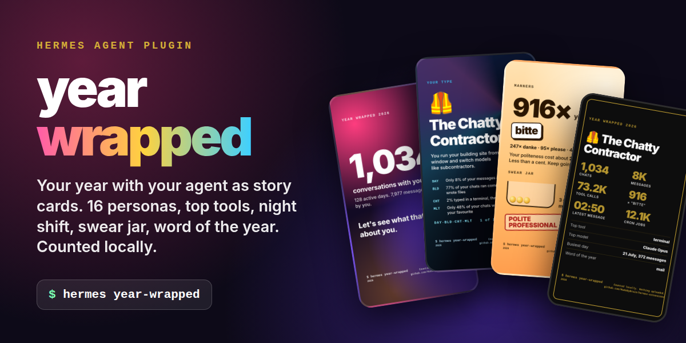
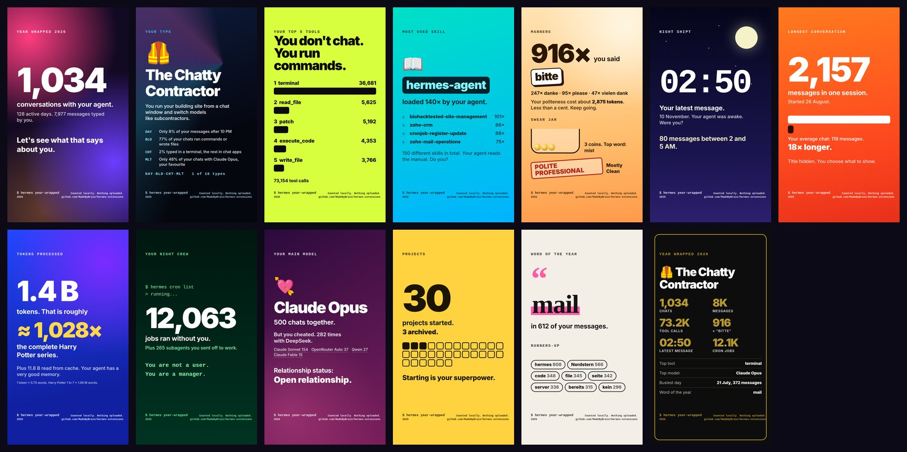

# year-wrapped: your year with your agent



Spotify has Wrapped. Your agent has a year too. `hermes year-wrapped` reads your own Hermes history and turns it into colourful story cards (1080 x 1920) you can post:

| Card | What it shows |
|---|---|
| Cover | chats, active days, messages you typed |
| Your type | one of 16 personas from four axes, with the real shares behind it |
| Top tools | your five most used tools |
| Most used skill | the skill your agent loaded most, plus the next four |
| Manners | please and thank you count, the swear jar and your rank |
| Night shift | your latest message (closest to dawn) and how many came after 10 PM |
| Longest conversation | the marathon chat compared with your average |
| Tokens | what your agent processed, measured in Harry Potter books |
| Night crew | cron jobs and subagents that worked without you |
| Main model | your favourite model, who you cheated with, relationship status |
| Projects | projects started vs. archived |
| Word of the year | the word you typed in the most messages |
| Summary | black and gold, the one people post |



Cards are self-contained HTML. When a headless Chrome or Chromium is installed, PNG files are rendered too. Everything is counted locally and read only. No model calls, no network, no telemetry.

## Not to be confused with

[hermes-wrapped](https://github.com/devpras22/hermes-wrapped) by devpras22 turns your week with Hermes into a 30 second video every Sunday. year-wrapped is the yearly, card based counterpart: static story cards, no video renderer, no cron job. Both can be installed side by side.

## Who it is for

- **Everyone who uses Hermes every day** and wants to see what that looks like after a year.
- **People who share their setup.** The cards are built for stories and feeds, and every card says that nothing was uploaded.
- **Teams and trainers, as a starting point.** It is a light way to start a conversation about how people work with their agent. It is not an analytics product: one profile, one machine, rough counts.

## Beyond this plugin

year-wrapped is free and stays free. Real usage reviews for a company need its own data and roles, so they are not a public plugin:

- dashboards across all users and profiles of a company instance;
- cost reports from the provider bills instead of estimates;
- reviews that show where a team loses time, which skills pay off and which are never used.

[MadeByBrain](https://madebybrain.com), the maintainer of this plugin, plans and builds such Hermes setups for businesses.

## Install

```bash
hermes plugins install MadeByBrain/hermes-extensions/plugins/year-wrapped --enable
```

Pin a release with `--ref <40 character commit SHA>` (tags are not accepted by `--ref`).

## Use it

```bash
hermes year-wrapped                          # this calendar year
hermes year-wrapped --year 2026
hermes year-wrapped --days 30
hermes year-wrapped --all
hermes year-wrapped --lang de                # en or de; default: setting, then auto
hermes year-wrapped --tz Europe/Berlin       # hours and days in your timezone
hermes year-wrapped --show-titles            # show the session title on the marathon card
hermes year-wrapped --rename acme=Northstar  # show a word under a code name (repeatable)
hermes year-wrapped --out ~/wrapped          # write the cards somewhere else
hermes year-wrapped --no-png                 # HTML only
hermes year-wrapped --json                   # raw numbers, no cards
```

Cards land in `<HERMES_HOME>/plugin-data/year-wrapped/<year>/` as `01-cover.html`, `01-cover.png` and so on, plus `index.html` with all cards side by side.

In any chat, `/year-wrapped` prints the summary and writes the HTML cards (`/year-wrapped 2025`, `/year-wrapped 30`, `/year-wrapped all`, `/year-wrapped json`). PNG rendering is left to the terminal command, so a chat never starts a browser.

Example summary (one real history, German setting):

```text
Year Wrapped 2026
890 Chats, 7.609 Nachrichten von dir, 124 aktive Tage
Dein Typ: Der gesprächige Bauleiter (DAY·BLD·CHT·MLT)
Top-Tool: terminal (34.838x)
Top-Skill: hermes-agent (140x)
Hauptmodell: Claude Opus (441 Chats)
Wort des Jahres: hermes (591 Nachrichten)
Manieren: 1.300x höflich, Schimpfglas 3
Späteste Nachricht: 01:30 am 13. August
Jobs, die ohne dich liefen: 11.728
Projekte angefangen: 29, archiviert: 3
```

## The 16 types

Four axes, each decided by a real share from your history. The persona card prints all four shares, so nobody has to trust a made up score.

| Axis | Letter | Rule |
|---|---|---|
| Night or day | NGT / DAY | NGT when at least 20 % of your messages were typed between 22:00 and 05:59 |
| Build or ask | BLD / ASK | BLD when in at least half of your chats the agent ran commands or wrote files (terminal, patch, write_file, execute_code, skill_manage, delegate_task and similar) |
| Terminal or chat | TRM / CHT | TRM when at least half of your messages came from the CLI or TUI |
| One model or many | ONE / MLT | ONE when at least 75 % of your chats used the same model family |

| Code | English | Deutsch |
|---|---|---|
| NGT·BLD·TRM·MLT | The 3 AM Architect | Der 3-Uhr-Architekt |
| NGT·BLD·TRM·ONE | The Midnight Mechanic | Der Mitternachtsmechaniker |
| NGT·BLD·CHT·MLT | The Insomniac Foreman | Der schlaflose Polier |
| NGT·BLD·CHT·ONE | The Moonlight Builder | Der Mondschein-Baumeister |
| NGT·ASK·TRM·MLT | The Nocturnal Interrogator | Der nächtliche Verhörer |
| NGT·ASK·TRM·ONE | The Terminal Owl | Die Terminal-Eule |
| NGT·ASK·CHT·MLT | The 2 AM Philosopher | Der 2-Uhr-Philosoph |
| NGT·ASK·CHT·ONE | The Late Night Confidant | Der Mitternachts-Vertraute |
| DAY·BLD·TRM·MLT | The Model Juggler | Der Modell-Jongleur |
| DAY·BLD·TRM·ONE | The Clockwork Builder | Der Uhrwerk-Baumeister |
| DAY·BLD·CHT·MLT | The Chatty Contractor | Der gesprächige Bauleiter |
| DAY·BLD·CHT·ONE | The Steady Foreman | Der verlässliche Vorarbeiter |
| DAY·ASK·TRM·MLT | The Benchmark Tourist | Der Benchmark-Tourist |
| DAY·ASK·TRM·ONE | The Command Line Monk | Der Kommandozeilen-Mönch |
| DAY·ASK·CHT·MLT | The Model Sommelier | Der Modell-Sommelier |
| DAY·ASK·CHT·ONE | The Loyal Pen Pal | Der treue Brieffreund |

## How it counts

- **Your chats only.** Sessions from `cron`, `subagent`, `kanban`, `batch`, `webhook` and `tool` are machine work. They are not counted as your chats or messages; cron runs and subagents appear on the night crew card, and their tokens count on the token card.
- **Only what you typed.** Code blocks, quoted lines, reply quotes, attachment lines and text Hermes injects as a user message (background notices, compaction summaries, delegation results) are skipped. Very long pastes count with their first 4,000 characters.
- **Time window.** A chat belongs to the period in which it started. Hours and days use the timezone setting, or the system time of the machine.
- **Tools and skills.** Tool calls are counted from the tool results in your chats; a skill counts when `skill_view` loaded it successfully.
- **Models.** Grouped by family (Claude Opus, Claude Sonnet, DeepSeek, GPT, Qwen and so on), one vote per chat.
- **Tokens.** Input plus output as stored by Hermes, cache reads shown separately. Book comparison: Harry Potter 1 to 7 is about 1.08 million words, roughly 1.4 million tokens.
- **No costs.** The cost columns in `state.db` are estimates that do not add up reliably across providers and subscriptions, so the cards show none.
- **Projects.** From the Hermes projects list (`projects.db`): projects created in the period and how many of them are archived. Without projects it counts the working folders of your chats and how many have been quiet for 30 days.
- **Word of the year.** The word you used in the most messages (each message counts once), at least four letters, without filler words in English, German, Spanish and French, links, paths, politeness and swear words. Add your own exclusions with `exclude_words`.
- **Manners.** Same word lists and ranks as the [manners-meter](../manners-meter) plugin, built in, so no second plugin is needed.

## Settings

Set with `hermes config set plugins.entries.year-wrapped.settings.<key> <value>` or in the Desktop plugin settings.

| Key | Default | What it does |
|---|---|---|
| `language` | `auto` | `auto`, `en` or `de`. Auto picks the language you are polite in most |
| `timezone` | empty | IANA name like `Europe/Berlin`. Empty = system time of this machine |
| `show_titles` | `false` | Show session titles on cards (same as `--show-titles`) |
| `exclude_words` | `[]` | Words never shown as word of the year, for example client names |
| `rename_words` | `[]` | Entries like `acme=Northstar`: the word of the year shows the code name instead (counts merge) |
| `excluded_sources` | `[cron, subagent, kanban, batch, webhook, tool]` | Sources that are not you |
| `browser_path` | empty | Chrome or Chromium for PNG. Empty = search for Chrome, Chromium, Edge, Brave or a Playwright headless shell |

## Data and privacy

- Reads `state.db` (and `projects.db` if present) of the active profile **read only** (`mode=ro`). Never writes to them.
- Writes only the cards, by default under `<HERMES_HOME>/plugin-data/year-wrapped/`. Before writing, old cards of the same period in that folder are replaced. With `--out` nothing else in the folder is touched.
- No network, no model calls, no telemetry. The cards load no fonts, scripts or images from anywhere.
- **Session titles are hidden by default.** They often name clients or projects. `--show-titles` shows one title, on the marathon card.
- **Check the word of the year before you post.** It is a word you typed, and that can be a client or project name. Exclude such words with `exclude_words`, or show them under a code name with `rename_words` / `--rename`. The preview above uses this for one client name.
- PNG export starts a local headless browser with the card file and nothing else. Snap packages of Chromium cannot read hidden folders such as `~/.hermes`; they are tried last. Set `browser_path` or use `--out` with a normal folder if PNG export fails.

## Tested

- 41 offline tests (filters, time windows, timezones, persona axes, tools, skills, projects, word of the year, singular and plural, escaping, read only access, index use, empty and old database schemas, CLI, slash command).
- `hermes plugins validate --json`: no warnings.
- Live in an isolated Hermes home (Hermes Agent v0.23.0, Claude Haiku 4.5 over OpenRouter): plugin installed from a local Git checkout of this folder, three real chat turns, then `hermes year-wrapped` and `/year-wrapped` through the real plugin manager against that new history; 10 cards written, 10 PNG rendered.
- One real history (1.7 GB `state.db`, about 7,600 typed messages, 11,700 cron sessions): numbers in about 2 seconds with a warm disk cache (about 20 seconds on a cold first read), 13 PNG cards in about 9 seconds more.
- Not tested yet: macOS and Windows (browser search covers the usual install paths), and `/year-wrapped` on Telegram, Discord and Desktop (same code path, not seen live).

## License

MIT. See [LICENSE](LICENSE).
